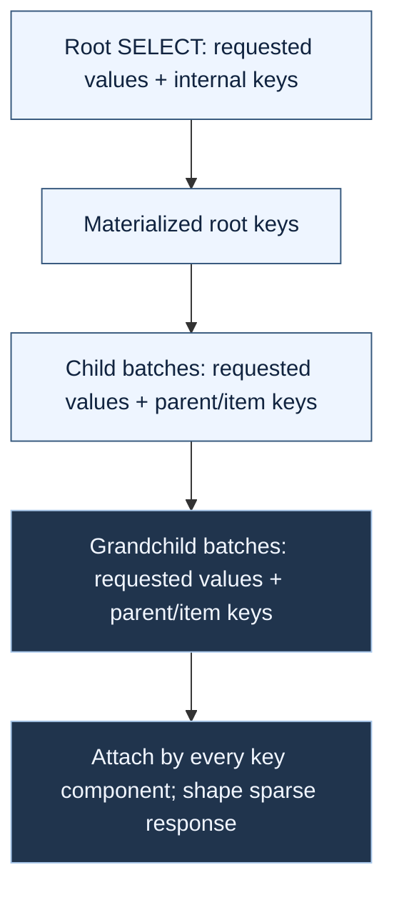

# Field projection

This guide explains how to select response properties and database columns with Expresso's projection parser and SQL/LINQ execution plans.

## Request behavior

Your application chooses the parameter name. All four samples use `fields` on list and by-id endpoints:

```http
GET /api/books?fields=title,year,authors.lastname
GET /api/books/1?fields=title,authors.awards.title
GET /api/authors?fields=lastname,awards
GET /api/publishers?fields=name,opens
```

The first request returns objects such as:

```json
[{"title":"Example","year":2024,"authors":[{"lastName":"Smith"}]}]
```

- Missing `fields` selects every public field and nested collection in the supplied projection catalog.
- A present empty or whitespace-only value returns HTTP 400 in the samples.
- Unknown names, empty path segments (`authors.`, `title,,year`), and paths continuing past a scalar (`title.length`) also return HTTP 400.
- Selected nulls remain present; unselected properties are absent.
- ASP.NET Core samples retain camelCase. .NET Framework samples retain PascalCase (`Title`, `Authors`).
- Projection does not change which rows match, the page, or the counts. Filtering and sorting may use unreturned fields.
- A repeated `fields` parameter binds only its first value in both sample frameworks. Send one comma-separated value.

The modern controllers declare sparse dictionary payloads in their `ActionResult<T>` return types; the legacy controllers
use `IHttpActionResult`. All four hosts supply explicit success-response metadata showing the full DTO as the available-field
superset in Swagger/OpenAPI. The `fields` selection determines which properties actually appear, including inside collections.
This metadata describes the JSON field shape, not the CLR object returned by the repository.

Names match the projection catalog ignoring case. For example, `opens` selects response property `opensAt`.
Whitespace around paths and segments is ignored; duplicates are removed.
A bare `authors` selects every author field and nested collection allowed by that catalog, including awards only when allowed.
If both `authors` and `authors.lastname` occur, the broader `authors` wins.
There are no wildcards and no OData `$select`/`$expand` grammar or package dependency.

The grammar is:

```text
fields = path *("," path)
path   = name *("." name)
name   = non-empty catalog name, excluding "," and "."
```

Each name is trimmed before lookup. Only collections allow another path segment.
See [Query syntax](query-syntax.md#projection-paths).

## Parse against the response allow-list

`AddRequestParametersParsers()` registers `IProjectionDirectiveParser`.
Both SQL and LINQ mappings expose `GetProjectionModel()`, derived only from their public response fields and collections.
Build and cache mappings and catalogs once, separately from filter/sort permissions:

```csharp
var model = bookProjection.GetProjectionModel();
var projection = projectionParser.Parse("title,authors.lastname", model);
```

`Parse(null, model)` expands the supplied catalog into an explicit selection tree.
Bare collections expand their allowed catalog subtree too, even when a broader renderer mapping is reused.
`QueryModel.Empty` produces `ProjectionDirective.Empty`: rows expose no public properties, only hidden execution keys are selected.
A selected collection with an empty item catalog returns item objects without public properties; it never expands extra mapping fields.
Selections are immutable and normalized. Trusted hand-built `ProjectionDirective.All` and `new ProjectionSelection("authors")`
still select the mapping's complete default subtree; they do not apply an independently supplied catalog.
Use `ProjectionSelection.Subtree(name, directive)` to build a bounded or empty collection selection explicitly.
Implement and register `IRequestProjectionModelProvider` for applications with multiple endpoint catalogs.
Projection permission is independent of filter/sort policy: allowing a field in predicates need not expose its values.

## Wire it into a controller

Both frameworks can bind `?fields=` to null. Do not pass that null directly to the parser: it means all catalog-permitted fields rather than invalid empty input.
Check whether the parameter was actually present:

```csharp
// ASP.NET Core
var present = Request.Query.ContainsKey("fields");
var selection = projectionParser.Parse(present ? fields ?? string.Empty : fields, model);

// ASP.NET Web API (.NET Framework)
var present = Request.GetQueryNameValuePairs()
    .Any(p => string.Equals(p.Key, "fields", StringComparison.OrdinalIgnoreCase));
var selection = projectionParser.Parse(present ? fields ?? string.Empty : fields, model);
```

Catch parsing `ArgumentException` and return HTTP 400 before repository access.
The samples centralize this normalization in `QueryParametersParser.ParseProjection(fields, parser, model, isPresent: present)`.
Do not convert mapping or provider translation failures into client errors.
See [Error handling](error-handling.md#projection-errors).

## Typed LINQ and EF mappings

Declare typed source selectors, DTO destinations, response names, initialized collections, and every identity component:

```csharp
using Expresso.Rendering.Linq;

var authorProjection = new LinqProjectionMapping<Author, AuthorResult>()
    .Key("tenant", a => a.TenantId)
    .Key("id", a => a.Id)
    .Field("lastname", "lastName", a => a.LastName, a => a.LastName);

var bookProjection = new LinqProjectionMapping<Book, BookResult>()
    .Key("tenant", b => b.TenantId)
    .Key("id", b => b.Id)
    .Field("title", "title", b => b.Title, b => b.Title)
    .Field("year", "year", b => b.Year, b => b.Year)
    .Collection("authors", "authors", b => b.Authors, b => b.Authors,
        authorProjection, new LinqQueryMapping<Author>().Field("lastname", a => a.LastName));

public sealed class AuthorResult
{
    public AuthorResult() { }
    public string LastName { get; set; } = "";
}

public sealed class BookResult
{
    public BookResult() { }
    public string Title { get; set; } = "";
    public short Year { get; set; }
    public ICollection<AuthorResult> Authors { get; set; } = new List<AuthorResult>();
}
```

Mapping requirements:

- DTOs have public parameterless constructors. Collection destinations implement initialized, mutable `ICollection<T>`.
- The executor clears selected collections before attaching queried rows; DTO constructor contents do not become results.
- Unselected members retain DTO defaults but are omitted from the sparse response.
- Each field/collection has a distinct destination. Scalar destinations are public writable/init properties or public writable fields.
- Keys are scalar member accesses rooted in the entity parameter. Captured/static selectors are rejected.
- Keys are internal: returning an `id` requires a separate public `Field` mapping.
- Configure the entire finite, acyclic tree before rendering. Rendering freezes LINQ mappings; sharing a subtree is allowed.

`IProjectionToLinqTransformer.RenderProjection` returns a plan whose `Selector` is a typed scalar
`Expression<Func<TEntity,TResult>>`. Collection execution uses the plan, not `Selector` alone.

For EF Core, filter/order/page the root and supply an unwindowed, authorized entity source for child lookup:

```csharp
using Expresso.Rendering.EntityFrameworkCore;
using Expresso.Rendering.Linq;

var transformer = new EfCoreExpressionToLinqTransformer(db.Database.ProviderName);
var projection = projectionParser.Parse(fields, model);
var authorizedBooks = db.Books.Where(b => b.TenantId == currentTenant);
var result = await authorizedBooks
    .Where(b => b.Price > 10)
    .OrderBy(b => b.TenantId).ThenBy(b => b.Id)
    .Take(20)
    .ToProjectedListAsync(transformer, projection, bookProjection,
        sort: sortDirective, cancellationToken: cancellationToken, keySource: authorizedBooks);
var response = ProjectionShaper.ToSparseObjects(result);
```

Include every key component as an ordering tie-breaker before paging.
For EF6, import `Expresso.Rendering.EntityFramework` and use the same signature with
`new Ef6ExpressionToLinqTransformer(db)`.
Adapters use the supplied transformer when it implements `IProjectionToLinqTransformer`;
custom clause-only transformers retain the standard projection fallback.
EF6 resolves derived parent types from their base entity set with `OfType`; TPH and TPT share this path.
EF Core resolves mapped derived entity roots directly. Composite-key correlation retains the requested subtype at each level.
Owned collection navigations retain their ownership scope, including multiple ownerships of the same CLR type.
Collection defaults apply unless that collection has explicit local sort keys. Sorting only awards does not remove the authors' default order.

EF providers control the final SQL. In particular, Oracle EF6 paging can retain unrequested
entity columns inside its `ROW_NUMBER` subquery, although the outer SELECT and returned
DTO remain projected. Unpaged root projections and the outer child SELECT lists are minimal.
Use the SQL renderer when every nested SELECT must have a strictly minimal column list.

The root query runs once. Child queries use materialized keys against `keySource`, without re-running the root's request filter, ordering, or page.
With an entity-source resolver, collection queries expand unique parent entity sources, constrained by a key-only `EXISTS` against the original authorized navigation source and their own materialized parent-key batch.
This preserves navigation restrictions and authorization without comparing unselected parent columns or repeating shared parents.
Ancestor batch predicates do not accumulate at each depth.
If requested collections need an implicit `keySource`, the library removes outer `OrderBy`/`ThenBy`/`Skip`/`Take`,
walking through `Where`, tracking wrappers, and EF6's tracking-mode wrapper. Filters remain for authorization safety.
It then checks the remaining outer source chain, including expressions exposed by wrapped query objects.
A remaining `Queryable.Skip` or `Queryable.Take` throws `InvalidOperationException` before any query runs,
asking for an explicit authorized, unpaged `keySource`. For example, this applies to `Take(...).TagWith(...)`,
`Take(...).Include(...)`, `Take(...).AsSplitQuery()`, `Take(...).IgnoreQueryFilters()`, and `Take(...).Select(x => x)`.
Unknown operators are not rewritten; paging in join inputs or lambda subqueries is not stripped or inspected by this outer-chain check.
Supply an explicit key source for complex joins/subqueries and to separate mutable request predicates from authorization.
Scalar-only projections do not need a child key source and do not run this check.
Never use a broader key source than the endpoint is authorized to access.

EF Core 8 respects `HasQueryFilter` in root and collection queries. To include filtered-out rows and their descendants,
use `IgnoreQueryFilters()` on the root scope and on an explicit `keySource` (or let the unpaged key source be inferred from that scope).
EF Core disables global filters for the entire composed query, including related entities, not just the set on which you call the method.
Keep required tenant/authorization predicates explicit in both scopes when ignoring global filters;
a tenant restriction configured only with `HasQueryFilter` is disabled too. Expresso does not add `IgnoreQueryFilters()` itself.

SQL Server temporal collection projection is not supported. The EF Core renderer and adapter throw `NotSupportedException`
before any query runs if the root, child key scope, or any selected collection mapping contains a temporal query root (`TemporalAsOf`, `TemporalAll`, or a temporal range).
Selected mapping scopes are composed and checked recursively before the root read, including collections selected as leaves.
Unselected mappings are not inspected, and an empty root result does not postpone validation of selected mappings.
This also applies to queries stored in captured variables and used inside composed queries, such as `SelectMany(_ => historical)`.
Validation inspects stored query expressions, including nested captured fields and boxed query values; it does not enumerate them.
For collection projection, opaque query-producing expressions inside the scope are rejected without evaluation. These include
properties, factory/delegate calls, element lookups, constructors, and custom conversions, even when their declared result is `IEnumerable<T>`.
Normal parameter-bound mapped navigations, including `EF.Property` with a stored mapped name, and standard LINQ filtering remain supported.
Mapped reference paths can use CLR members or `EF.Property` at each step before reaching a collection.
Built-in derived entity casts (`(Derived)entity` or `entity as Derived`) retain the derived navigation metadata,
including inside `EF.Property` and reference paths, for both TPH and TPT inheritance. Restrict the query to the
appropriate subtype when selecting subtype-only mappings; projection does not make an unsafe runtime cast safe.
Widening query stages such as `Cast<IInterface>()`, `OfType<IInterface>()` and `Cast<object>()` retain known
entity metadata through later filters and EF wrappers. Mapped collection access through the interface or
`EF.Property` remains supported when the original query translates. This does not permit unmapped members
or infer an entity type from an interface member's name.
Collections carried by `Select`, `Join`, `GroupJoin`, or `SelectMany` projections are traced to their defining expressions;
standard `GroupJoin`/`DefaultIfEmpty` left joins work without evaluating intermediate getters.
Tracking, query-tag, filter and splitting wrappers retain those definitions. Conditional intermediate rows retain every branch's definition;
an unsafe inactive branch is still rejected. Source-less LINQ generators such as `Enumerable.Empty<T>()` remain supported.
Stored query values are recognized regardless of their declared type.
Safely stored `Expression<Func<...>>` predicates/selectors are inspected and bound like inline lambdas, including selected child mappings.
Expression-producing getters/factories, expression-tree lookups and recursive/uninspectable arguments are rejected without evaluation.
Store the already-created expression in a local variable before composing the query. This does not permit a temporal source hidden in its body.
Materialized BCL collections such as arrays, lists, and sets are accepted without enumeration; unknown/deferred non-query captures are rejected.
Extracting a query/sequence value from a container with `First`, `Single`, `ElementAt`, their default variants, or an aggregate
is rejected for both `Enumerable` and `Queryable`, even for a current query. Scalar lookups (for example an integer key) remain supported.
Flattening unseen query/sequence elements from a captured container is rejected too; query-defined collection rows remain supported.
Store a query-producing result in a local `IQueryable` variable before
composing the query instead. This does not enable temporal collection support; a stored historical query is still rejected.
Conditional/coalesced query expressions are inspected on every branch, so a temporal branch is rejected even if not currently selected.
Scalar-only temporal projections remain supported and keep their historical SQL. Ordinary current queries over temporal tables also work.
Load a historical graph explicitly in the host if required; projection never silently combines historical parents with current children.

Catalog matching uses ordinal, case-insensitive comparison consistently in parsing and rendering, including non-ASCII equivalents
such as Greek final sigma and sigma. Mapping-defined SQL columns and response output names are unchanged.
Unicode equivalence follows the target runtime's ordinal comparer; .NET Framework does not recognize every equivalence recognized by modern .NET.



The adapters use no-tracking queries and construct DTOs, not partially populated tracked entities.
Always call `ProjectionShaper.ToSparseObjects(result)` before serialization.
Serializing `result.Items` directly would include unselected DTO defaults.
An optional `Field(..., outputConverter)` runs after materialization, never in SQL.

## Composite keys, cost, and consistency

- Declare every ordered key component at each entity level. Each complete identity must uniquely identify its entity.
- Keys compare by value, component by component; `byte[]` compares by content. Repeated Ids in different tenants do not cross-attach.
- A complete child identity is deduplicated per parent relationship. Rows with incomplete child identities are preserved, but cannot anchor further child lookup.
- Parents with incomplete identities receive empty requested collections. Internal keys never enter the response.
- `ProjectedResult.GetKey(index)` exposes root identity for application-owned operations without adding DTO fields.

Execution costs one root query plus one query per batch for each requested collection at each level.
With small results, `books → authors → awards` takes three queries; missing `fields` loads the whole catalog-permitted graph.
Empty roots and unrequested collections cause no child queries.
Many-to-many navigation paths can produce repeated entities. The EF adapters resolve unique entity query roots automatically,
then check membership in the authorized navigation scope using every declared key component. An author's awards are therefore
read once per author batch, not once for every book that author wrote. Ancestor joins can remain inside the membership check;
this does not authorize broader access or eliminate all ancestor traversal costs.
No full-entity `DISTINCT` is used at any collection level, including plain one-to-many chains and the default full response.
Unselected SQL Server `xml`/`text`/`ntext`/`image`/`geography`/`geometry`, Oracle CLOB/NCLOB/BLOB, PostgreSQL `json`, and DB2 LOB columns
are not compared for deduplication. Declared keys still need provider-supported equality, and selected values follow normal provider support.
Providers may retain unused entity columns inside an inner join SELECT, but those columns are neither fetched by the outer projection
nor operands of a full-entity equality operation.

Custom execution providers can implement `IProjectionSourceValidator.ValidateSource(IQueryable)` alongside their entity-source capability.
For requested collections, the plan validates root, child key, and every selected mapping-composed navigation scope before the first read.
Validation must not execute the query, and scalar-only plans do not run this collection capability.

For custom execution providers, `IProjectionEntitySourceProvider.GetEntitySource(IQueryable source, Type entityType)` is an optional
transformer/materializer capability. Return a compatible, unpaged unique entity query; Expresso retains the original scope by key membership.
Returning the supplied source itself asserts that it is already unique and scoped. Built-in EF adapters supply this capability even with
custom clause-only transformers; hosts do not need to resolve DbSets themselves. A materializer's non-null result takes precedence over the
renderer's resolver. Without a resolver (or when it returns null), the first collection level uses the caller's authorized `keySource`
directly, without grouping. This supports `QueryableExpressionToLinqTransformer` plans with custom executors for scalar and
first-level collections, including the default response when the mapping has only one collection level.
At deeper levels, LINQ-to-objects groups by structural projection keys. Other provider-backed queries need a resolver or support for
key-grouping/navigation translation. For nested EF collections, use the EF transformer or `ToProjectedListAsync` adapter, or supply
`IProjectionEntitySourceProvider` in a custom executor. Unsupported deeper translations remain provider/configuration errors;
no client-side full-entity fallback is used. A resolver-less first-level key source must not duplicate parent identities.
Cap page size, requested depth, and response field count in the host to control cost.

The portable budget is 500 scalar key components per child query.
Set `ProjectionExecutionOptions.MaxKeyParameters` (LINQ) or `SqlProjectionExecutor.ExecuteAsync(..., maxKeyParameters: ...)` (SQL).
Non-positive budgets fail immediately; a positive budget smaller than one complete composite key fails during execution.
Two components consume two slots per parent. Reserve room for sort parameters and provider limits.
Single non-binary LINQ keys use a captured `Contains` list; composite/binary keys use structural equality predicates.
Providers decide whether a list is one array parameter or expanded values.

Different field combinations create different query shapes and database plans.
Shaping metadata and normalized child directives are reused per plan; mappings/catalogs should also be cached.
Batch lengths can still change provider query shapes, particularly for composite keys.

Split reads are not a snapshot. With an explicit unpaged key source, children are looked up by materialized root keys, independent of later root-page changes.
Concurrent deletion, relationship changes, or authorization changes can still remove/change children between reads.
Use an application-owned transaction with suitable snapshot/isolation semantics when consistency is required.

## SQL projection execution

Each dialect registration exposes `IProjectionToSqlTransformer`.
Applications own root FROM/joins/filter/order/page composition and SQL I/O; the Common library owns child batching, nested sorting, ordinal shaping, deduplication, and attachment.

SQL Server example with composite book and author keys:

```csharp
using Expresso.Rendering;

var authors = new SqlProjectionMapping()
    .Key("tenant", "a.tenant", typeof(int)).Key("id", "a.id", typeof(int))
    .Field("lastname", "lastName", "a.last_name", typeof(string));
var books = new SqlProjectionMapping()
    .Key("tenant", "b.tenant", typeof(int)).Key("id", "b.id", typeof(int))
    .Field("title", "title", "b.title", typeof(string))
    .Collection("authors", "authors", new SqlCollectionProjectionMapping(
        "[book_author] [ba] JOIN [author] [a] ON [a].[tenant] = [ba].[tenant] AND [a].[id] = [ba].[author_id]",
        authors, new[] {
            new SqlProjectionKey("tenant", "ba.tenant", typeof(int)),
            new SqlProjectionKey("id", "ba.book_id", typeof(int)) },
        defaultOrderBy: "[a].[last_name], [a].[tenant], [a].[id]",
        queryMapping: new SqlQueryMapping(new Dictionary<string, string> { ["lastname"] = "a.last_name" })));
var renderer = new ExpressionToSqlServerQueryClauseTransformer();
var selection = projectionParser.Parse("title,authors.lastname", books.GetProjectionModel());
var plan = renderer.RenderProjection(selection, books);
var rootSql = "SELECT " + plan.SelectList + " FROM [book] [b] ORDER BY [b].[tenant], [b].[id]";
var executor = new SqlProjectionExecutor(renderer, renderer);
var response = await executor.ExecuteAsync(plan, rootSql, new Dictionary<string, object>(), io,
    sort: sortDirective, cancellationToken: cancellationToken);
```

Here `io` implements `IProjectionSqlQueryExecutor`: bind supplied parameters, read values in `plan.Columns` order,
convert to each column's CLR type, and represent database NULL with null.
The library does not open/dispose your connection or create a transaction.
See the sample's [ADO adapter](../samples/Expresso.Sample.Shared/DataAccess/ProjectedSampleRepository.cs).

For selected root keys `(1,10)` and `(2,10)`, the SQL Server child query is:

```sql
SELECT [a].[last_name] AS [c0], [a].[tenant] AS [c1], [a].[id] AS [c2], [ba].[tenant] AS [c3], [ba].[book_id] AS [c4]
FROM [book_author] [ba] JOIN [author] [a]
  ON [a].[tenant] = [ba].[tenant] AND [a].[id] = [ba].[author_id]
WHERE ([ba].[tenant] = @key_0 AND [ba].[book_id] = @key_1)
   OR ([ba].[tenant] = @key_2 AND [ba].[book_id] = @key_3)
ORDER BY [a].[last_name], [a].[tenant], [a].[id]
-- @key_0=1, @key_1=10, @key_2=2, @key_3=10
```

`Fields` exposes `lastName` at ordinal 0. `KeyOrdinals = [1,2]` identifies each author;
`ParentKeyOrdinals = [3,4]` attaches it to the matching book. Hidden columns never appear in JSON.
Identical expressions/types/raw flags share one physical selected column.

`DefaultOrderBy` is used unless that collection has a nonempty requested `sortfor`.
Then `QueryMapping` renders the requested ordering and binds its parameters; it must be configured for that collection.
Sorting may use a column not selected for the response.

SQL mapping requirements:

- Every root and item mapping declares identity, including scalar-only leaves.
- Declare all keys before adding collections.
- Parent correlation includes every parent component in the same name/type/order; nullable/nonnullable variants of the same CLR type are compatible.
- Missing, duplicate, reordered, incompatible, and cyclic mappings fail before SQL execution.

### Match text-key equality to your database

SQL correlations use database equality, while default materialized key equality is structural CLR equality (ordinal for strings).
For text keys, use canonical parent-side correlation values in your child SELECT or configure equality that matches the actual key
and correlation collations. Do not assume every database is case-insensitive. For example, for a two-component identity whose first
component is numeric and second component uses matching case-insensitive text equality:

```csharp
using Expresso.Core.Projection;

var parent = new SqlProjectionMapping()
    .Key("tenant", "p.tenant", typeof(int))
    .Key("code", "p.code", typeof(string))
    .UseKeyComparer(new CompositeProjectionKeyComparer(null, StringComparer.OrdinalIgnoreCase));
```

Configure each entity mapping independently. Its comparer also controls child-to-parent attachment and relationship deduplication
at that level; a grandchild's foreign components use its parent's comparer. Null component comparers retain structural equality,
including binary content comparison. Original key values remain unchanged in predicates and responses.
Comparer component counts must match the ordered identity. Custom comparers must provide consistent equality and hash codes.
`OrdinalIgnoreCase` is not a universal SQL collation emulator: accents, locale rules and padded text may require a custom
`System.Collections.IEqualityComparer` per component. Padding normalization must follow the database's rules, not indiscriminately trim text.
The comparer cannot repair a mismatched SQL predicate collation; configure the FROM/correlation expressions consistently too.

Quoting rules:

- Plain dotted identifiers (`a.last_name`) are dialect-quoted in both SELECT and generated correlation predicates.
- An unqualified name such as `title` is emitted unquoted in a projection SELECT, whereas a filter field map quotes it (`[title]` on SQL Server). Prefer alias-qualified column names such as `b.title`.
- Bare expressions such as `CURRENT_TIMESTAMP`, `NULL`, and functions are used as trusted SQL, not mistaken for identifiers.
- Use `rawExpression: true` on `Field`, `Key`, or `SqlProjectionKey` to bypass automatic dotted-identifier quoting.
- Prequoted expressions, FROM/join text, and `DefaultOrderBy` are used as written. Quote aliases consistently, especially on Oracle.
- Client paths resolve only through the response allow-list; never concatenate them into expressions or fragments.
- Omitted fields do not automatically remove existing joins.

## Validation and provider limits

Malformed/unknown paths throw `ArgumentException`; null catalogs throw `ArgumentNullException`.
Invalid mappings and unsupported provider translations are server configuration errors, not client errors.
All six SQL dialects, EF Core, and EF6 support composite-key projection.
Existing provider function restrictions still apply to filters/sorts.
Sample-specific DB2 paging and EF6 clock workarounds are documented in [Sample applications](sample-app.md#selecting-response-fields).

See [Field providers](field-providers.md), [SQL rendering](rendering.md), and [LINQ rendering](linq-rendering.md).
